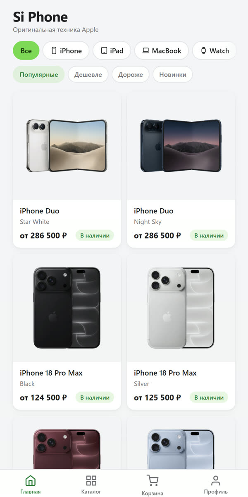
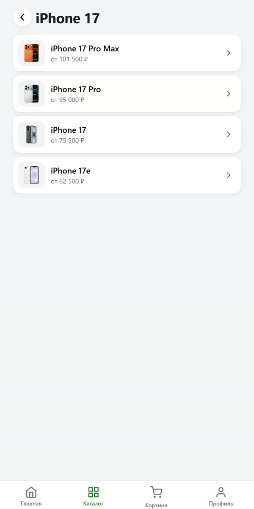
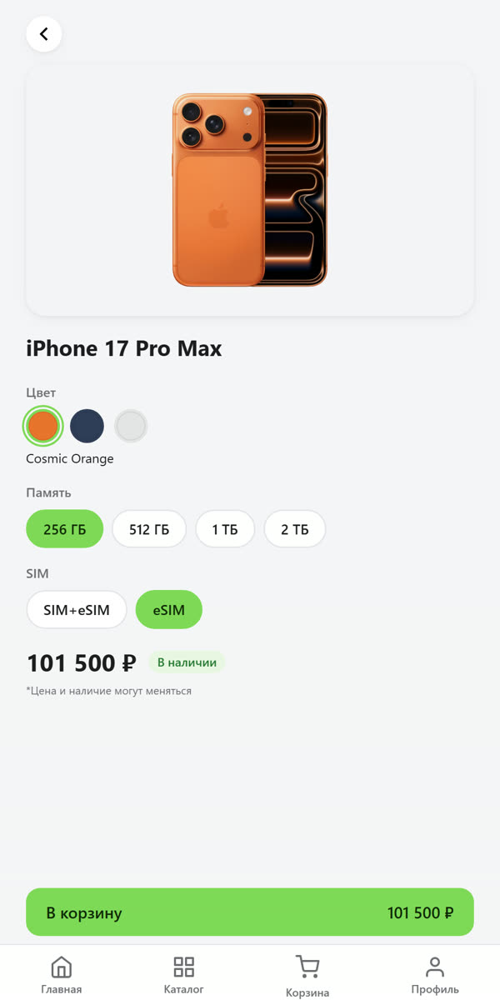
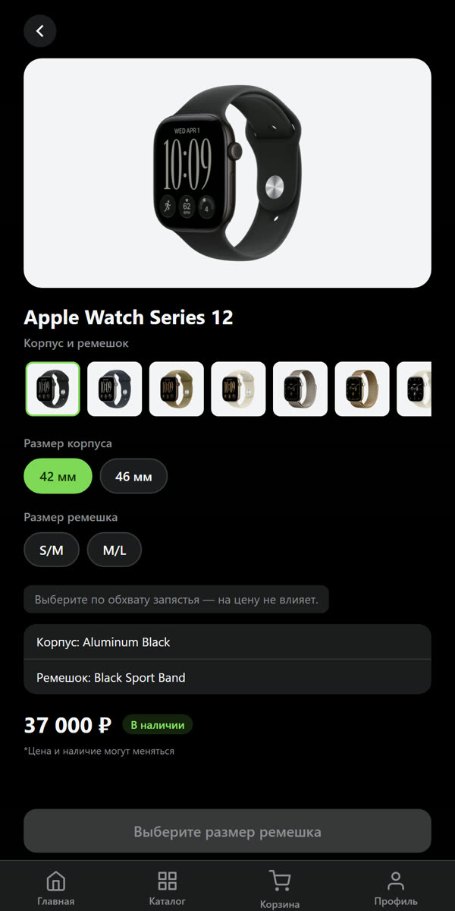

# Si Phone — Telegram Mini App магазина техники Apple

**Интернет-магазин внутри Telegram:** покупатель открывает бота, листает каталог iPhone, iPad, MacBook, Apple Watch и AirPods, выбирает комплектацию и оформляет заказ, не выходя из Telegram. Заказ сразу приходит менеджерам в чат.

**Открыть магазин:** [@si_phone_bot](https://t.me/si_phone_bot) · веб-версия — [si-phone.vercel.app](https://si-phone.vercel.app)

<p>
  
  
  
  
</p>

## Что умеет

**Для покупателя (мини-приложение)**
- Главная — все товары карточками по цветам, вкладки категорий, сортировка «популярные / дешевле / дороже / новинки».
- Каталог плашками: категория → поколение → модель (например, iPhone → iPhone 17 → 17 Pro Max).
- Карточка товара: цвет → память → SIM (iPhone, iPad), конфигурация (MacBook), корпус, размер и **размер ремешка** (Apple Watch). Цена и наличие меняются сразу.
- Корзина и оформление в стиле настроек Telegram: самовывоз или доставка, оплата наличными или переводом, телефон — по желанию.
- Светлая и тёмная тема как в Telegram, системные кнопки «Назад» и «Оформить», вибрация.

**Для магазина (админка внутри Telegram)**
- Вход по Telegram-аккаунту из списка админов (в браузере — по паролю).
- Товары и цены: поиск, ручная правка цены, скрытие позиции.
- Загрузка прайса поставщика текстом или Excel: распознаёт позиции, показывает, что изменится, и применяет после подтверждения.
- Цены в рублях пересчитываются по курсу ЦБ автоматически два раза в день.
- Новые модели и позиции, до 5 фото на цвет с автоматической подготовкой (фон убирается, товар по центру).
- История изменений цен и настроек.

**Бот**
- Кнопка «Открыть магазин», частые вопросы, отзывы, связь с менеджером. Отвечает готовыми текстами, без нейросети.

## Как устроено

| Часть | Технологии | Где работает |
|---|---|---|
| `mini-app/` — витрина и админка | React 19, TypeScript, Vite, Zustand, Telegram WebApp API | Vercel |
| `mini-app/supabase/` — база и сервер | PostgreSQL (Supabase), RLS, Edge Functions на Deno, pg_cron | Supabase |
| `bot/` — Telegram-бот | TypeScript, Cloudflare Workers, KV | Cloudflare |

```
Покупатель в Telegram
   ├─ бот (Cloudflare Worker) ─ кнопки, ответы, отзывы
   └─ мини-приложение (Vercel)
        ├─ каталог ──────────► Supabase (только чтение)
        ├─ заказ ────────────► create-order ─► база + сообщение менеджерам
        └─ админка ──────────► admin-login, admin-catalog (только для админов)
```

## Безопасность

- Покупатель определяется только по подписи Telegram (`initData`), проверка — на сервере.
- **Персональные данные (152-ФЗ):** в базе их нет — заказ хранится обезличенно, имя, телефон и адрес получают только менеджеры в Telegram. Для лимитов — HMAC-отпечатки Telegram ID и IP, живут сутки. Политика и отдельное согласие — `/privacy`, `/consent`, без галочки заказ не принимается.
- Цены и сумма заказа считаются на сервере по базе; цены из корзины не принимаются. Лимит частоты заказов.
- Публичный ключ даёт только чтение витрины. Закупочные данные, заказы и все функции админки закрыты (RLS, токен админа).
- Вход в админку: проверка Telegram-аккаунта по списку или пароль с лимитом попыток.
- Ключи — только в секретах Supabase, Vercel и Cloudflare. Репозиторий проверяется Gitleaks, Semgrep и OSV-Scanner.

## Запуск локально

```bash
cd mini-app
npm install
cp .env.example .env.local   # адрес и публичный ключ Supabase
npm run dev                  # http://localhost:5173
```

Бот — см. [`bot/README.md`](bot/README.md). Устройство мини-приложения — [`mini-app/README.md`](mini-app/README.md).
