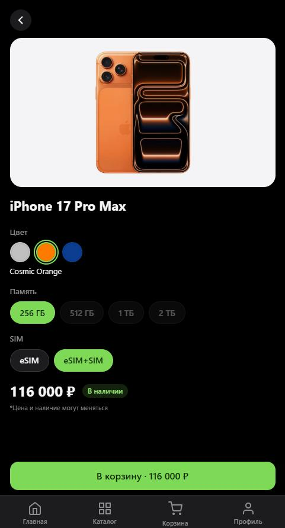
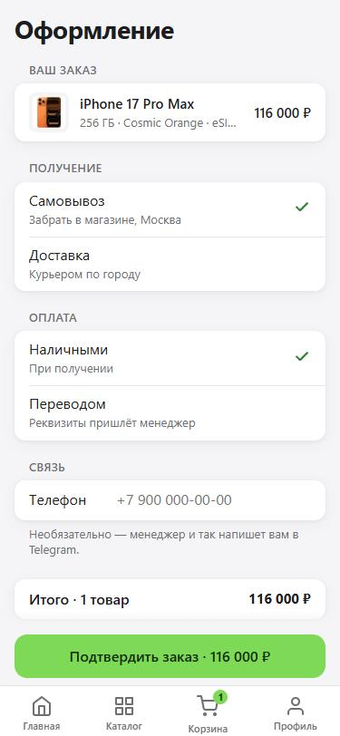

# Si Phone — магазин техники Apple в Telegram

Telegram Mini App и бот для магазина оригинальной техники Apple: каталог с ценами, подбор комплектации, корзина и оформление заказа прямо в Telegram; заказы приходят менеджерам в чат.

**Живая версия:** [@si_phone_bot](https://t.me/si_phone_bot) · сайт мини-приложения — [si-phone.vercel.app](https://si-phone.vercel.app)

<p>
  
  
  
  
</p>

## Что умеет

**Мини-приложение**
- Каталог по категориям (iPhone, iPad, MacBook, Apple Watch, AirPods), сортировка, фильтры.
- Карточка iPhone/iPad: выбор «цвет → память → SIM» с живой ценой и наличием; MacBook и Watch — список вариантов.
- Корзина и оформление в стиле настроек Telegram: самовывоз или доставка (при доставке — только перевод), телефон по желанию.
- Тема как в Telegram (светлая/тёмная) с переключателем в профиле, системная кнопка «Назад», вибрация, скелетоны вместо крутилок, пустые экраны с иллюстрациями.
- Админка (`/admin`, вход по паролю): цены из файла поставщика, фото товаров.

**Бот**
- Зелёная кнопка «Открыть магазин», частые вопросы по разделам, отзывы, связь с менеджером.
- Отвечает на свободный текст по ключевым словам (без нейросети), понимает уточняющие вопросы и доставку в другие города.
- Админам — кнопки «Админка» и «Добавить отзыв».

## Как устроено

| Часть | Технологии | Где работает |
|---|---|---|
| `mini-app/` | React 19, TypeScript, Vite, Zustand, Telegram WebApp API | Vercel (Root Directory — `mini-app`) |
| `mini-app/supabase/` | Postgres (Supabase), RLS, Edge Functions на Deno | Supabase |
| `bot/` | TypeScript, Cloudflare Workers, KV | Cloudflare (`si-phone-bot`) |

```
Покупатель в Telegram
   ├─ бот (Cloudflare Worker) — вебхук с секретом, кнопки, ответы
   └─ мини-приложение (Vercel) ── читает каталог ──► Supabase (только чтение, RLS)
                                └─ заказ ──► Edge Function create-order ──► база + сообщение менеджерам
```

## Безопасность

- Заказ проверяет подпись Telegram (`initData`) на сервере; цены и суммы берутся из базы, а не из запроса.
- Каталог открыт только на чтение; заказы, хранилище фото и админ-функции закрыты политиками RLS и проверкой токена админа.
- Вход в админку: пароль от 16 символов, лимит попыток (атомарно в базе), «доверенное устройство».
- CORS — только адрес магазина; вебхук бота принимает запросы только с секретом Telegram.
- Ключи — только в секретах Supabase / Cloudflare / Vercel, в репозитории их нет (проверяется Gitleaks; плюс OSV-Scanner и Semgrep).

## Запуск локально

```
cd mini-app
npm install
cp .env.example .env.local   # адрес и публичный ключ Supabase
npm run dev                  # http://localhost:5173
```

Бот: `cd bot && npm install`, токен для локального запуска — в `bot/.dev.vars` (образец — `bot/.env.example`). Подробнее — [`bot/README.md`](bot/README.md).

## Документы

- [`PLAN.md`](PLAN.md) — план работ, решения и история изменений.
- [`mini-app/supabase/DEPLOY-SECURITY.md`](mini-app/supabase/DEPLOY-SECURITY.md), [`bot/DEPLOY.md`](bot/DEPLOY.md) — выкладка.
- [`mini-app/brand/splash/`](mini-app/brand/splash/) — экран загрузки для BotFather.
- `CLAUDE.md`, `AGENTS.md`, `NEXT-CHAT-PROMPT.md` — инструкции для ИИ-помощников, с которыми велась работа.
